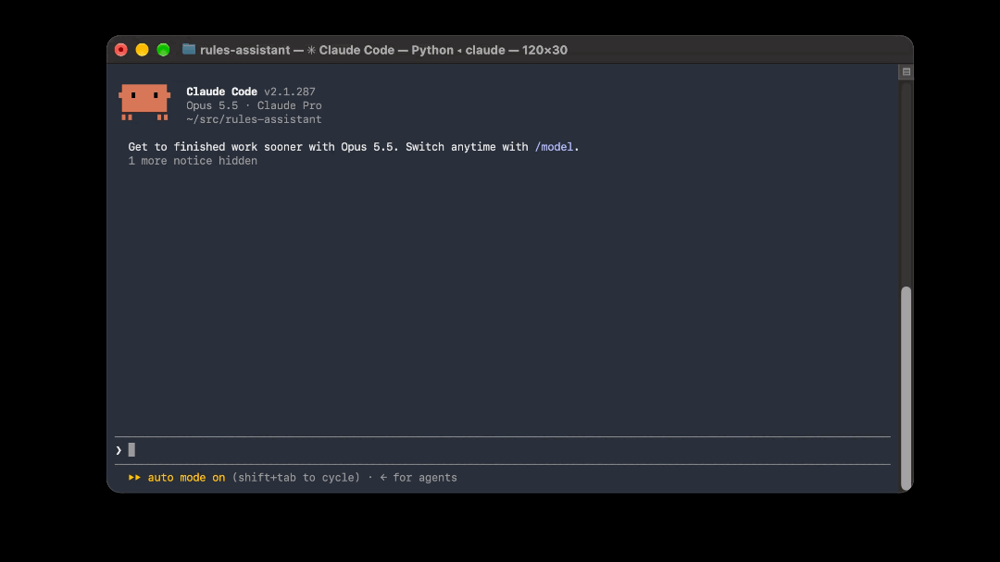
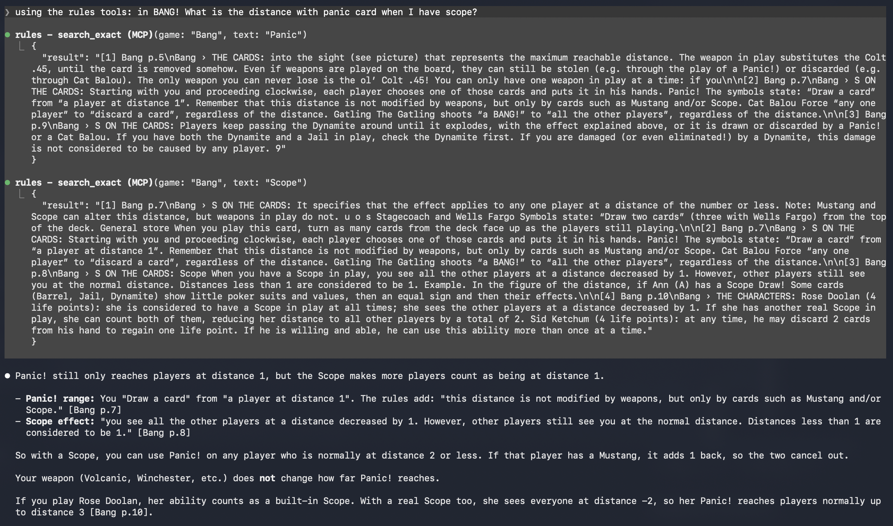

# Board Game Rules Assistant

Answers board game rules questions from PDF rulebooks, with quoted rules and page citations.
Usable as a CLI, a FastAPI service, or an MCP server for AI clients such as Claude Code.
Games: Terraforming Mars (rules + fan FAQ), Everdell, BANG!.

## MCP Preview




## MCP Output



## How to run

Requires [uv](https://docs.astral.sh/uv/) and [Ollama](https://ollama.com). Rulebooks aren't included (copyright); add your own PDFs as `data/pdfs/<game>_<source>.pdf`.

```bash
uv sync
ollama pull nomic-embed-text && ollama pull llama3.1:8b
mkdir -p data/pdfs                # then copy your PDFs here, e.g. bang_rules.pdf
uv run python src/ingest.py       # build the index
uv run python src/ask.py --game bang "What is the distance with Panic?"
```

Full guide in [docs/SETUP.md](docs/SETUP.md): options (`--game`, `RULES_MODEL`), the agent, the API, Docker, the MCP server in Claude Code, and the evals.

## Architecture

```
PDF rulebooks ─► ingest ─► Chroma (chunks + embeddings)
                                  │
                         retrieval core (search functions)
              ┌───────────────────┼────────────────────┐
         MCP server         FastAPI service       CLI + evals
      (AI clients, e.g.    (apps, end users;     (measuring)
       Claude Code)         my prompt + model)
```


## Technologies

| Technology | What it does here |
|---|---|
| Python + uv | Language; uv manages Python, dependencies and the lock file |
| PyMuPDF | Extracts text from PDFs, with fonts and positions (used to detect headings and reading order) |
| Ollama | Runs models locally: `nomic-embed-text` for embeddings, `llama3.1:8b` for answers |
| Chroma | Local vector database: stores chunks with metadata (game, source, page, section) |
| Claude Haiku 5.5 (API) | Stronger answering model, about $0.0002–0.0007 per question |
| LangChain | Standard model interface (Claude or Ollama), `@tool` turns functions into tools, `create_agent` |
| LangGraph | Runs the agent loop: model → tools → model, with state and a step limit |
| FastAPI | Web API with automatic validation and interactive docs |
| Docker | Packages the API so it runs the same anywhere |
| MCP (FastMCP) | Exposes the search tools to any MCP client |

## Files

| File | What it does |
|---|---|
| `src/ingest.py` | PDF → reading-order text → sections → chunks (≤ 500 chars, sentence boundaries, numbered steps separate) → "Game › Section:" prefix → embeddings → Chroma. Rebuilds from scratch. |
| `src/ask.py` | Single search: `retrieve()` top 5 chunks, then one model call with the Quote/Answer prompt |
| `src/agent.py` | Agent with 3 tools: `search_rulebook`, `search_faq` (Terraforming Mars only), `search_exact` (keyword); max 6 tool calls |
| `src/api.py` | FastAPI service around the single search and the agent |
| `src/mcp_server.py` | MCP server exposing the search tools |
| `src/find.py` | Debug tool: which chunks contain a text, and where they rank for a question |
| `eval/questions.json` | Test set |
| `eval/retrieval_eval.py` | Rank of the right chunk per question |
| `eval/answer_eval.py` | Runs all questions from `eval/questions.json`, writes CSV + `.xlsx` for hand grading |
| `AGENTS.md` / `CLAUDE.md` | Instructions for coding agents (commands, conventions, secrets rules); CLAUDE.md imports AGENTS.md |

## FastAPI

- `GET /health`, `GET /games`, `POST /ask` with question, game, mode (single or agent) and model.
- Model chosen per request from an allowlist (`llama3.1:8b`, `claude-haiku-5-5`), so callers can't pick expensive models.

## Docker

- Image with uv, dependencies installed from the lock file, plus code and the Chroma index.
- API keys are never in the image; passed at run time with `-e ANTHROPIC_API_KEY`.
- Embeddings still come from Ollama on the host, reached via `OLLAMA_HOST=http://host.docker.internal:11434`.

## MCP server

- Exposes `list_games`, `search_rulebook`, `search_faq`, `search_exact` over stdio.
- Exposes the tools, not the agent: the client's model (e.g. Claude Code) does the reasoning, so no second model and no extra cost.
- Models via MCP: Claude Code's model for reasoning, local Ollama for embeddings. Haiku isn't used.
- Never print to stdout: the protocol uses it.

## Eval setup

- **Retrieval eval:** for each question, where does the chunk containing the expected text (`must_contain`) rank? No chat model involved.
- **Answer eval:** every question through single search or the agent (`--agent`); results in CSV and `.xlsx`, graded by hand. `chunk_retrieved` shows automatically whether the right text was retrieved. `--previous` shows earlier grades and whether the answer changed.
- Model chosen with `RULES_MODEL` (default local llama).

## Grading rule and metrics

- **Correct:** all key facts present. **Partial:** right final answer, a key fact missing. **Wrong:** wrong final answer, or refusing when the answer exists. **Bad question:** the test itself was wrong; fixed and excluded.
- **Cause:** retrieval (right text not retrieved) or model (retrieved but answered wrong).
- **recall@5:** share of questions with the right chunk in the top 5. Main retrieval number.
- **MRR:** average of 1/rank; rewards ranking the right chunk high.
- **Confident wrong:** wrong answers stated with confidence; more harmful than refusals.

## Test set

- 24 questions across 3 games, each with the question, the expected answer, `must_contain` text and a type: lookup, implicit, list, interaction (two rules combined), FAQ, not in the rules.

## Results

| Setup | Correct (of 24) | Confident wrong | Tool calls | Time per question | Cost per run |
|---|---|---|---|---|---|
| llama3.1:8b, single search | 11-14 (3 runs) | several | 1 search | ~4 s | $0 |
| Haiku 5.5, single search | 15–16 (2 runs) | 0 | 1 search | ~2 s | ~$0.005 |
| Haiku 5.5, agent (3 tools) | 21 (in all 3 runs) | 0 | 2.1 | ~3.2 s | ~$0.016 |

Grades per run: see [eval/results/summary.md](eval/results/summary.md).

## Key findings

- **Data quality first:** most early failures came from chunking (mid-word cuts, table-of-contents entries like "Player Boards: 6", shredded component lists), not the model.
- **Model vs retrieval:** llama failed on questions combining two rules; Haiku fixed those, making retrieval the bottleneck.
- **Haiku: zero confident wrong answers.** It states precisely what the excerpts don't cover.
- **Semantic vs keyword search:** embeddings can't tell "3 life points" from "4 life points"; a keyword tool fixed it in 2 calls.
- **Agent:** fixed every retrieval failure (21/24 correct in all 3 runs, zero confident wrong answers) at about 3× the cost of single search.
- **More context isn't free:** on one question the agent retrieved the right sentence among ~20 chunks and still missed it, a regression compared to single search.

## Limitations

- Embeddings need local Ollama, so no cloud deployment or full eval in CI yet (would need hosted or in-container embeddings and a re-ingest).
- Small test set (24 questions), tuned on during development; no held-out set yet.
- PDF extraction issues remain on some pages (sidebars, decorative letters, icons).
